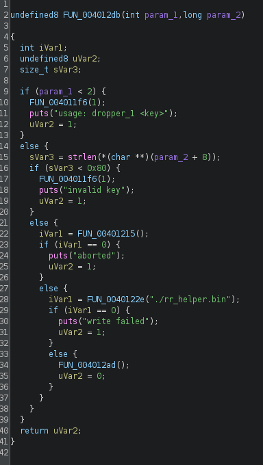
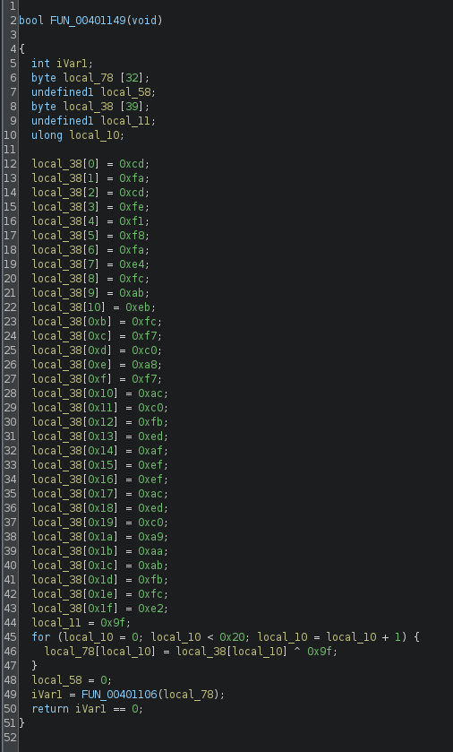

# Dropper 1 (C)
## Challenge: <https://rerange.org/challenges/>

Hello hackers, today we are going to try something new. I recently found out about this platform which aims to be a playground for learning reverse engineering. 
So today, I will be trying the first challenge.

This challenge is available in both `exe` and `elf` formats. Lets try to retrieve the flag. 

Lets start by analyzing the elf file using `Ghidra`.

It is a `ELF 64-bit LSB executable`

The main function looks as such



We can see this executable, as the name suggests, acts like a dropper. It takes input as an arg and checks its length. If the length is 0x80 (128), it creates another .bin file called `rr_helper.bin`

Lets analyse that file now



We can see a set of characters, that is being XORed with `0x9f`

Logic found. Lets write a python script to XOR each of those chars with `0x9f` to obtain the flag. 

```py
encoded = b"\xcd\xfa\xcd\xfe\xf1\xf8\xfa\xe4\xfc\xab\xeb\xfc\xf7\xc0\xa8\xf7\xac\xc0\xfb\xed\xaf\xef\xef\xac\xed\xc0\xa9\xaa\xab\xfb\xfc\xe2"
for byte in encoded:
    print(chr(byte^0x9f), end="")
```

We get the correct flag when we run the script. Hence, challenge solved. 
It was a fairly easy challenges that involves basic analysis and XOR. 

I will see you with another writeup soon, till then
Happy Hacking!
