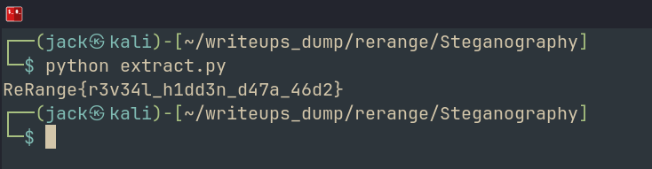

# Steganography
## Challenge: <https://rerange.org/challenges/>

Hello Hackers!
Today we will be tackling another challenge from ReRange, and it is a `Hard` challenge. This is the only hard one available on the site and has only 5 solves at the time of writing. So this is going to be fun. 

Challenge description says: 

> Reverse this steg program and write the extraction program to get the hidden flag from the image. The key used to embed was ‘stegosaurus’.

We recieved a binary as well as an image. So the objective is pretty clear, we need to figure out how the message is embeded into the image, which can be done by analysing the binary provided. 

It is a

```
embed: ELF 64-bit LSB pie executable, x86-64, version 1 (SYSV), dynamically linked, interpreter /lib64/ld-linux-x86-64.so.2, BuildID[sha1]=a10dc62f0fb6c87cd5f4e5d4855fc307a6fb1a89, for GNU/Linux 3.2.0, stripped
```

Running `strings` on the binary, this is the interesting bit we recieve:

```
Usage: embed <coverfile> <num_bits 1-8> <msgfile> <key>
Number of bits must be 1-8.
Failed to read cover file.
Cover too small.
Failed. Need %zu unique bytes, have %zu.
Picking unique positions failed.
embedded_
Writing output failed.
Embedded %zu bytes (%zu bits) using %d LSB(s) per UNIQUE byte (carriers=%zu).
Key: %s
Output: %s
Invalid number of bits to embed.
Failed to read msg file.
```

Analysing using `diec` reveals no protection

```
ELF64
    Compiler: GCC((Debian 12.2.0-14+deb12u1) 12.2.0)
    Library: GLIBC(2.34)[DYN AMD64-64]
```

Let's directly hop onto `ghidra` and try to figure out whats happeneing

The function with which our program starts is `FUN_00101c02`

Let's map out properly. The function has a basic if-else, to check the number of arguments, which is supposed to be 5 (including the binay name). Else, it prints usage. 

Now digging into the if statement, we see a particularly interesting function, `FUN_001016de`. Analysing it, we realise that it is the main steg function that we need to reverse in order to obtain the flag. 

```c
local_34 = steg(local_10,local_14,local_30,local_48,local_28);
```

We can see a lot of checks in this function as well. But good news, we can ignore all of that because we already have an embedded image, ie, all the checks already passed. We just need to focus on what happened after the checks. 

Lets analyse the function deeply, rename variables, and remove the checks and other lines of code that do not affect the actual steg to obtain a simplified mechanism. 


```c
if (iVar1 == 0) {
    FUN_00101403(local_38,6,carrier & 0xffffffff);
    local_10 = 0;
    for (local_18 = 0; local_18 < carrier; local_18 = local_18 + 1) {
        local_19 = *(byte *)((long)local_38 + (ulong)*(uint *)((long)local_60 + local_18 * 4));
        for (local_20 = 0; local_20 < (int)num_bits; local_20 = local_20 + 1) {
            local_21 = 0;
            if (local_10 < secretsizebits) {
                local_98 = local_10 >> 3;
                local_9c = ~(uint)local_10 & 7;
                local_21 = (byte)((int)(uint)(byte)secret[local_98] >> (sbyte)local_9c) & 1;
            }
            local_19 = local_21 << ((byte)local_20 & 0x1f) | ~(byte)(1 << ((byte)local_20 & 0x1f)) & local_19;
            local_10 = local_10 + 1;
        }
        *(byte *)((ulong)*(uint *)((long)local_60 + local_18 * 4) + (long)local_38) = local_19;
  }
  local_30 = coverfile;
  local_68 = strrchr(coverfile,0x2f);
  if (local_68 != (char *)0x0) {
    local_30 = local_68 + 1;
  }
  local_70 = (long)local_30 - (long)coverfile;
  memcpy(outimg,coverfile,local_70);
  local_78 = "embedded_";
  local_80 = strlen("embedded_");
  memcpy(outimg + local_70,local_78,local_80);
  local_88 = strlen(local_30);
  memcpy(outimg + local_70 + local_80,local_30,local_88);
  outimg[local_88 + local_70 + local_80] = 0;
  fails = FUN_00101386(outimg,local_38,local_a8);
  free(local_60);
  free(local_38);
  if (fails == 0) {
    printf("Embedded %zu bytes (%zu bits) using %d LSB(s) per UNIQUE byte (carriers=%zu).\n" ,secretsize,secretsizebits,(ulong)num_bits,carrier);
    printf("Key: %s\n",key);
    printf("Output: %s\n",outimg);
    iVar1 = 0;
```

Further analysis reveals the core mechanism of the embedder. Let's write python functions that do the reverse of what the embedder does. 

```c
      local_58 = local_a8 - 0x36;
      if (local_58 < carrier) {
```

Here we can see the reference to 0x36 (54). Which is the size of a bmp header. So its to verify bmp format.  

```c
{
  buffer[offset] = (char)value;
  buffer[offset + 1] = (char)(value >> 8);
  buffer[offset + 2] = (char)(value >> 0x10);
  buffer[offset + 3] = (char)(value >> 0x18);
  return;
}
```

Here we notice that buffer[6:10] is used, and clearly, buffer is out bytestream from the bmp. 

After writing the python wireframe for all the functions, all we need to do is reverse the bitwise operators and convert the write instructions to read instructions. 

After some research, it is clearly visible that the program uses `Fisher Yates Shuffle`, `Linear Congruential Generator`, etc.
These functions dont need to be reversed, only the steg_rev will be reversed. 

The `extract.py` script has been attached alongside and can also be accessed via my github repo. 

Running it, we retrieve the flag. 



And thats how we solve this challenge

> ReRange{***}

This was certainly a very interesting challenge, and a pretty difficult one for me. I was introduced to a lot of new techniques and it did take me a lot of time to figure out. But it was pretty fun and I was hooked :)

That's it for today's writeup, I will see you soon with another one. Until then, 

Happy Hacking! 