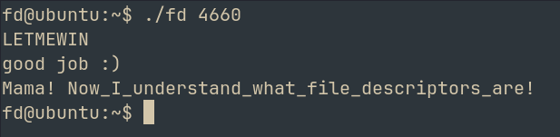

# fd 
## Challenge: <https://pwnable.kr/play>

Hello everyone, welcome to this series where i'll be providing writeups for all the challenges on pwnable.kr

Today we will be trying out the first challenge, fd. 
Since this is the first challenge, I recon it will be very easy

The site instructs us to connect to the machine via SSH

After login, we see our files

Let's move all of it to our local machine 

```bash
scp -P 2222 -r fd@pwnable.kr:/home/fd .
```

1. fd.c

```c
#include <stdio.h>
#include <stdlib.h>
#include <string.h>
char buf[32];
int main(int argc, char* argv[], char* envp[]){
	if(argc<2){
		printf("pass argv[1] a number\n");
		return 0;
	}
	int fd = atoi( argv[1] ) - 0x1234;
	int len = 0;
	len = read(fd, buf, 32);
	if(!strcmp("LETMEWIN\n", buf)){
		printf("good job :)\n");
		setregid(getegid(), getegid());
		system("/bin/cat flag");
		exit(0);
	}
	printf("learn about Linux file IO\n");
	return 0;

}
```

The challenge hints us to learn about file descriptors
--> In Linux, a file descriptor (FD) is a non-negative integer that serves as a unique per-process handle assigned by the kernel to manage any open input/output stream

> **The fd binary has SUID**
So it runs as root and we can read the file

### Understanding the logic behind the code

```c
int fd = atoi( argv[1] ) - 0x1234;
```

The argument which we pass to the program, it's converted to its int equivalent (atoi) and then 0x1234 is subtracted from it

```c
len = read(fd, buf, 32);
```

What this means: we are reading fd, and we are storing the first 32 bytes into the "buf" which is a user defined 32 byte buffer

```c
if(!strcmp("LETMEWIN\n", buf))
```

strcmp compares two strings based off their ascii values. It returns 0 for true

Since we can control the **file descriptor** here, set it to 0
WHY: Because 0 is the FD for standard input
ie, then we can just pass what the condition requires us to in order to obtain the flag

The int value of 0x1234 is 4660

Giving 4660 as arg, the program halts
--> It is waiting for our input

Entering **LETMEWIN** and pressing enter, we get good job

Repeat the process on the target machine to reveal the flag


_________________________________

# ALTERNATE APPROACH (DOES NOT RETRIEVE FLAG)

This is not the way the developers intended this challenge to be solve, but we can basically modify registers to trigger the winning funtion

In gdb, 

```bash
set disassembly-flavor intel
set follow-fork-mode parent                # for reading the flag, the binary invokes a child process where main() isnt defines --> error
disassemble main
```
```asm
   0x0000120d <+0>:	lea    ecx,[esp+0x4]
   0x00001211 <+4>:	and    esp,0xfffffff0
   0x00001214 <+7>:	push   DWORD PTR [ecx-0x4]
   0x00001217 <+10>:	push   ebp
   0x00001218 <+11>:	mov    ebp,esp
   0x0000121a <+13>:	push   esi
   0x0000121b <+14>:	push   ebx
   0x0000121c <+15>:	push   ecx
   0x0000121d <+16>:	sub    esp,0x1c
   0x00001220 <+19>:	call   0x1110 <__x86.get_pc_thunk.bx>
   0x00001225 <+24>:	add    ebx,0x2d97
   0x0000122b <+30>:	mov    eax,ecx
   0x0000122d <+32>:	cmp    DWORD PTR [eax],0x1
   0x00001230 <+35>:	jg     0x124e <main+65>
   0x00001232 <+37>:	sub    esp,0xc
   0x00001235 <+40>:	lea    eax,[ebx-0x1fb4]
   0x0000123b <+46>:	push   eax
   0x0000123c <+47>:	call   0x1080 <puts@plt>
   0x00001241 <+52>:	add    esp,0x10
   0x00001244 <+55>:	mov    eax,0x0
   0x00001249 <+60>:	jmp    0x1306 <main+249>
   0x0000124e <+65>:	mov    eax,DWORD PTR [eax+0x4]
   0x00001251 <+68>:	add    eax,0x4
   0x00001254 <+71>:	mov    eax,DWORD PTR [eax]
   0x00001256 <+73>:	sub    esp,0xc
   0x00001259 <+76>:	push   eax
   0x0000125a <+77>:	call   0x10c0 <atoi@plt>
   0x0000125f <+82>:	add    esp,0x10
   0x00001262 <+85>:	sub    eax,0x1234
   0x00001267 <+90>:	mov    DWORD PTR [ebp-0x1c],eax
   0x0000126a <+93>:	mov    DWORD PTR [ebp-0x20],0x0
   0x00001271 <+100>:	sub    esp,0x4
   0x00001274 <+103>:	push   0x20
   0x00001276 <+105>:	lea    eax,[ebx+0x84]
   0x0000127c <+111>:	push   eax
   0x0000127d <+112>:	push   DWORD PTR [ebp-0x1c]
   0x00001280 <+115>:	call   0x1060 <read@plt>
   0x00001285 <+120>:	add    esp,0x10
   0x00001288 <+123>:	mov    DWORD PTR [ebp-0x20],eax
   0x0000128b <+126>:	sub    esp,0x8
   0x0000128e <+129>:	lea    eax,[ebx+0x84]
   0x00001294 <+135>:	push   eax
   0x00001295 <+136>:	lea    eax,[ebx-0x1f9e]
   0x0000129b <+142>:	push   eax
   0x0000129c <+143>:	call   0x1040 <strcmp@plt>
   0x000012a1 <+148>:	add    esp,0x10
   0x000012a4 <+151>:	test   eax,eax
   0x000012a6 <+153>:	jne    0x12ef <main+226>
   0x000012a8 <+155>:	sub    esp,0xc
   0x000012ab <+158>:	lea    eax,[ebx-0x1f94]
   0x000012b1 <+164>:	push   eax
   0x000012b2 <+165>:	call   0x1080 <puts@plt>
   0x000012b7 <+170>:	add    esp,0x10
   0x000012ba <+173>:	call   0x1070 <getegid@plt>
   0x000012bf <+178>:	mov    esi,eax
   0x000012c1 <+180>:	call   0x1070 <getegid@plt>
   0x000012c6 <+185>:	sub    esp,0x8
   0x000012c9 <+188>:	push   esi
   0x000012ca <+189>:	push   eax
   0x000012cb <+190>:	call   0x10b0 <setregid@plt>
   0x000012d0 <+195>:	add    esp,0x10
   0x000012d3 <+198>:	sub    esp,0xc
   0x000012d6 <+201>:	lea    eax,[ebx-0x1f88]
   0x000012dc <+207>:	push   eax
   0x000012dd <+208>:	call   0x1090 <system@plt>
   0x000012e2 <+213>:	add    esp,0x10
   0x000012e5 <+216>:	sub    esp,0xc
   0x000012e8 <+219>:	push   0x0
   0x000012ea <+221>:	call   0x10a0 <exit@plt>
   0x000012ef <+226>:	sub    esp,0xc
   0x000012f2 <+229>:	lea    eax,[ebx-0x1f7a]
   0x000012f8 <+235>:	push   eax
   0x000012f9 <+236>:	call   0x1080 <puts@plt>
   0x000012fe <+241>:	add    esp,0x10
   0x00001301 <+244>:	mov    eax,0x0
   0x00001306 <+249>:	lea    esp,[ebp-0xc]
   0x00001309 <+252>:	pop    ecx
   0x0000130a <+253>:	pop    ebx
   0x0000130b <+254>:	pop    esi
   0x0000130c <+255>:	pop    ebp
   0x0000130d <+256>:	lea    esp,[ecx-0x4]
   0x00001310 <+259>:	ret
```

From the above and from the code, we can see exactly where the comparison takes place
```asm
0x000012a4 <+151>:	test   eax,eax
```
here, the value of strcmp is being compared to 0 --> Strings match
Just trying to set eax=0 before the test to bypass the restrictions

> Get the address after running the file and breaking at main
```asm
0x565562a4 <+151>:	test   %eax,%eax
```
```bash
(gdb) break *0x565562a4
Breakpoint 2 at 0x565562a4
(gdb) continue
Continuing.

Breakpoint 2, 0x565562a4 in main ()
(gdb) set $eax=0
```

Fingers crossed.....
And boom

```bash
(gdb) continue
Continuing.
good job :)
```


Again, this is not the intended way to do it, the challenge is supposed to teach you about FD
But this is another vuln
But since gdb isnt run as root, flag will say permission denied

Happy Hacking :)
