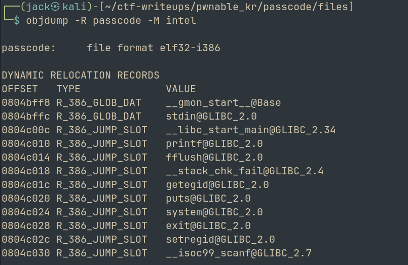

# passcode
## Challenge: <https://pwnable.kr/play>

Hello Hackers!

Welcome back to another writeup on a pwnable.kr challenge
Today we will be looking at **passcode**

The hint:

Mommy told me to make a passcode based login system.
My first trial C implementation compiled without any error!
Well, there were some compiler warnings, but who cares about that?

--> 'Compiler warnings' looks interesting

Let us read the source code

From the source code, we find:

> ha! mommy told me that 32bit is vulnerable to bruteforcing :)

That is interesting. Maybe it has to do something with bruteforcing

The file looks simple enough with checks of passcode1 = 338150 and passcode2 = 13371337
But when we try to run the binary and use these creds, we get a segmentation fault. 

Lets try to compile the binary ourself to see what warnings were encountered

Well we cant, because the original code is a lil different. We get error while trying to complile

Lets analyze the binary using BinaryNinja

Another flaw we notice is that passcode1 and 2 expect pointer but get int (%d in scanf)
--> in scanf("%d", smtg), the smtg is the destinaion address. Hence we need to pass &passcode1 

After some research, we find that fflush(stdin) is the problem 

What happens is that we enter out passcode1
Then when it flushes, it doesnt know which destination to put it in because the given destination is not even an address
So if we just execute the flagread instead of fflush(), we can retrieve the flag

Lets analyze the functions and addresses using **pwndbg**

```asm
0x08049000  _init
0x08049040  __libc_start_main@plt
0x08049050  printf@plt
0x08049060  fflush@plt
0x08049070  __stack_chk_fail@plt
0x08049080  getegid@plt
0x08049090  puts@plt
0x080490a0  system@plt
0x080490b0  exit@plt
0x080490c0  setregid@plt
0x080490d0  __isoc99_scanf@plt
0x080490e0  _start
0x08049120  _dl_relocate_static_pie
0x08049130  __x86.get_pc_thunk.bx
0x08049140  deregister_tm_clones
0x08049180  register_tm_clones
0x080491c0  __do_global_dtors_aux
0x080491f0  frame_dummy
0x080491f6  login
0x080492f2  welcome
0x08049364  main
0x080493c0  __stack_chk_fail_local
0x080493d8  _fini
```

When we use cyclic pattern as name, we find that SEGMENTATION FAULT occurs at 0x61616179 at 'yaaa'

```bash
cyclic -l yaaa
Finding cyclic pattern of 4 bytes: b'yaaa' (hex: 0x79616161)
Found at offset 96
```
Hence we found the  offset to be 96

So we can use the GOT address of fflush and the address that gives us the flag
And if we craft our exploit carefully we should be able to pwn this

--> NOTE: to dump GOT, use: 
```bash 
objdump -R passcode -M intel
```



Writing exploit.py (attached)

We retrieve the flag!

> s0rry_******_w4rning

Another challenge down. We learnt about the implications caused by scanf, fflush() and also about GOT addresses.

See you with another writeup soon, till then

Happy Hacking!
