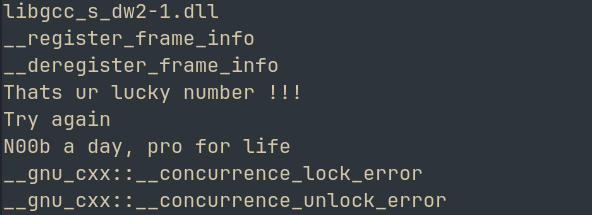
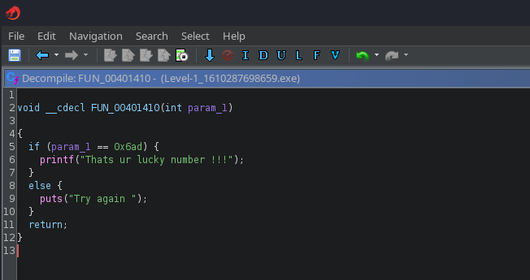
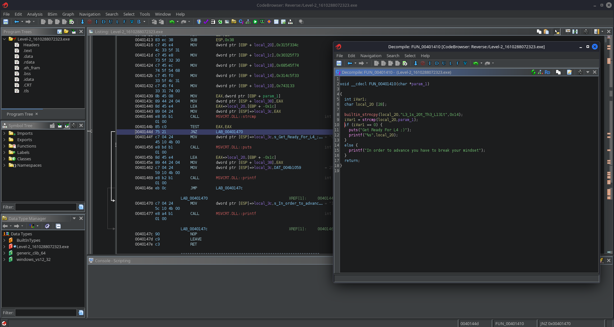
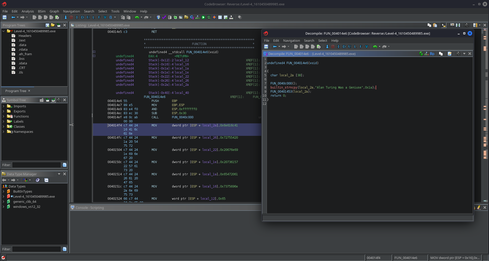

# REloaded
## Challenge: <https://tryhackme.com/room/reloaded>

Hello Hackers!
Welcome back to another writeup. Today we will be looking at a room from THM which deals with Reverse Engineering. 
It is a `hard` room rating and it is long with multiple binaries to analyze. So lets begin. 

1. Level 0

Initial thoughts:
--> It is a windows executable
--> PE32 executable for MS Windows 4.00 (console), Intel i386 (stripped to external PDB), 8 section

Lets begin by using `strings` on the exe. 
--> We find usual stuff that is found in exe files like .dll references, etc.
--> We ALSO find an interesting piece of string

Thats the flag :)

2. Level 1

Moving on to the second binary, we see it is similar to the first one in terms of platform, architecture, etc.

--> From the `strings` output, we can see we need to find a `lucky number`



Lets try to analyze the file using `ghidra`, and searching for the 'lucky number' section



--> We see the input is compared to  `0x6ad` (1709) 

3. Level 2

Moving on to the third binary, it has the same pattern. Maybe we are only dealing with such exe files for this room. Anyway, lets begin. 
The task says:

> As a security analyst, you found some suspicious app in your organization which enables employees secretly share their file to the rival organization.  Your task is to find who is involved in this treachery, but the app needs some key to log in. Can you patch this app to bypass Authentication?

Let's start by running strings on the file. We find an interesting snippet:

```text
Get Ready For L4 ;)
In order to advance you have to break your mindset
Wow Ur At L3?
```

Lets search for this in ghidra and see what we are working with. 

Searching for those strings and reading through the functions, we find our required input and also the instruction



4. Level 3

Lets start with the next binary, again with the same architecture, etc. 

The task says:

> Bob was fired due to his inappropriate behavior with colleagues. While leaving he deleted the code which decrypts the password stored in the code. As a reverse engineer it's your task to recover that master password since the code is in prod now and cant is modified but you have a copy of the app. everything depends on you now  !!!

So it is pretty clear that we need to decrypt a password obtained from the code

Running `strings`, we find this interesting snippet:

```text
Rooted !!!
Enter the flag ::
```

Let's analyze the file using `ghidra` and search for this string to find the interesting function. 

Looking through the file, we can see the hex values that we need to convert to ASCII to obtain the password

Writing a simple python script, 


```py
l = [0x54, 0x48, 0x4d, 99, 0x74, 0x66, 0x2d, 0x4c, 0x34, 0]

for i in l:
	print(chr(i), end="")
print()
```

We find the flag

5. Level 4

Now moving on to the last and final binary of this room, and just as the above pattern, it follows the same architecture. 

The task says:

> They are back!!! and using some sort of encryption algorithm to communicate. Although we intercepted their messages we cant decode them, Agent 35711 has successfully stolen their test encryption code. Now it's on you to build a decryptor for test messages and save this world.

So we have passwords to decrypt. Lets get to work. 

Running our routine `strings` check, but this time we don't really find anything too interesting. 

Lets directly move on to static analysis using `ghidra`

Strange, given the task description, but we directly find the string that is being compared. 



And just like that, we have completed this long room. It was mostly based on static analysis and finding secrets hidden inside binaries. Overall, a pretty fun room.

So that's it for this writeup, I will see you soon with another one. Until then, 

Happy Hacking!