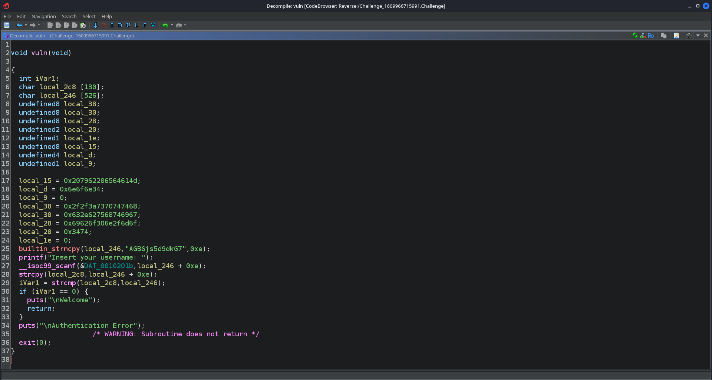
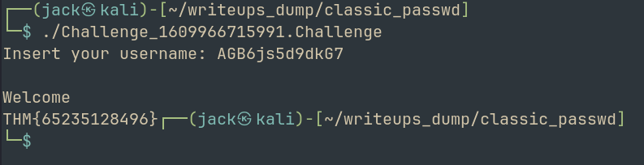

# Classic Passwd
## Challenge: <https://tryhackme.com/room/classicpasswd>

Hello Hackers!

Welcome back to another writeup. Today we will be exploring another reversing challenge from THM. The room is rated medium difficulty. 
So without wasting any time, lets get to work. 

The task says:

> I forgot my password, can you give me access to the program?

So the goal is pretty clear. We need to analyze the binary and find a password. 

From our initial analysis using `file`, we can see that the binary is `ELF 64-bit LSB pie executable`. 

Let's try running `strings` and see if we find anything interesting in here. 
We find an interesting snippet:

```text
Insert your username: 
Welcome
Authentication Error
THM{%d%d}
```

This is probably the part which we need to further analyze to find the password. 

Let's fire up `ghidra`

We see the function that will lead us to the flag, called `vuln()`

Analyzing the function, we can directly see the required username that yields the flag.

)

> AGB6js5d9dkG7



> THM{...}

This was a fairly simple challenge, although rated medium.

That is it for this writeup, I will see you soon with more stuff to break into. Until then,

Happy Hacking!